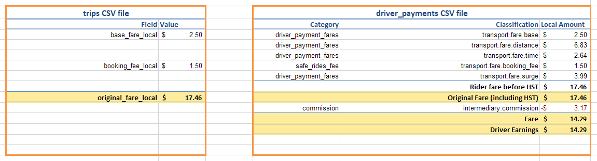
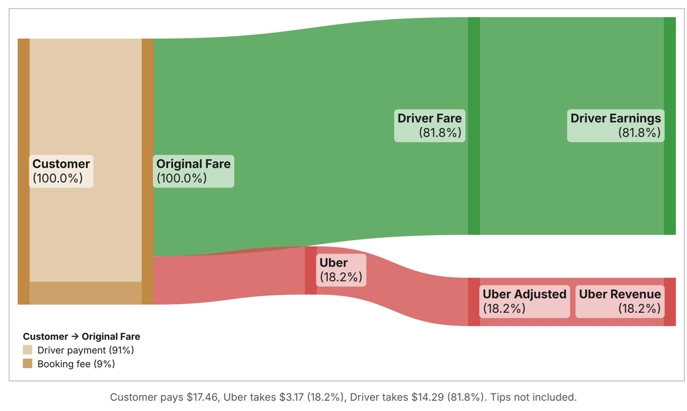
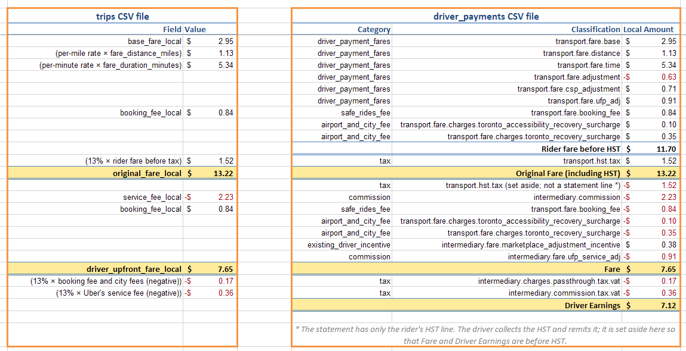
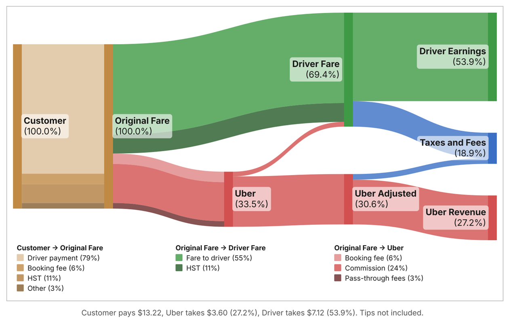

Uber drivers can request a copy of their account from Uber, and they get a zip file containing several CSV files.
Of these, two are particularly important for Uber ridehail drivers.
These are in the Driver folder:

- *driver_payments-0.csv* ("Payments") contains payment records for each trip.
  Each trip has a set of line items, one on each row.

- *driver_lifetime_trips-0.csv* ("Trips") contains summary information about each trip as a single row.

The statements are complex and difficult to understand.
This post is the first of a series that unpicks the details of these account statements to derive a picture of how Uber has decided to pay its drivers over the years.
It draws from account statements passed to me by Uber drivers: thank you for sharing them with me!

**(If you are an Uber driver and would like a report on your account to explain where the money goes, I would be happy to supply one.
Please contact me.
If you would let me use your data for research purposes, keeping the specifics confidential, that would be great.
All trip examples displayed here are anonymized.)**

# Making sense of a 2016 trip

@tbl-2016-raw shows a typical record from the Payments file for a trip in 2016.
It reflects Uber's business at the time.
I'm going to walk through it in a probably-unnecessarily-boring way to pick out what matters from these account statements.

::: {#tbl-2016-raw}
  | Category             | Classification             | Local Amount |
  | :------------------- | :------------------------- | -----------: |
  | driver_payment_fares | transport.fare.base        |       \$2.50 |
  | driver_payment_fares | transport.fare.distance    |       \$6.83 |
  | driver_payment_fares | transport.fare.time        |       \$2.64 |
  | driver_payment_fares | transport.fare.surge       |       \$3.99 |
  | safe_rides_fee       | transport.fare.booking_fee |       \$1.50 |
  | commission           | intermediary.commission    |      -\$3.17 |

  : Driver payment record for a typical Uber trip in 2016.
    This trip includes a "surge" payment.
:::

Each line item has a category and a (finer-grained) classification, and a "Local Amount", which in this case is in Canadian dollars.
The driver_payment_fares line items work similarly to a traditional taxi fare, with a base fare, a distance rate (per mile) and a time rate (per minute).
Uber also applied "surge" pricing to some trips, and this trip includes that additional amount.
This way of calculating fares (base + time + distance) is often called a "rate card" fare, so this trip has a rate card fare of \$11.97, a booking fee of \$1.50, and a surge addition of \$3.99.
Uber takes a commission, sometimes called a "take rate" of 18%, which appears as a deduction (negative amount).

The passenger also paid a booking fee, and the original framing of this as a "safe rides fee" persists in the category, although Uber later dropped the idea that this was a payment specifically to provide safety.

To make sense of this statement, it helps to match the trip with its entry in the Trips file.
This is not so easy, because while Payments includes a *trip_uuid* unique identifier for each trip, Trips does not.
However, we can match most trips by their start time, and @fig-2016-record is a display of the Payments file with what matches it in the Trips file.
We can now understand a bit more about this trip.

The Original Fare is what the passenger paid.
It looks like this left the driver with earnings of \$14.29 but this is a bit misleading, as the booking fee goes to Uber.
In later statements, as we shall see, there is an additional line item that shows the deduction of the booking fee from the driver's balance.
So for this trip, the passenger paid \$17.46, the driver took \$12.79 (73% of the fare), and Uber took \$4.67 (27% of the fare).

The Trips file also includes the actual duration and distance of the trip, so we can work out that the rate card amounts are \$0.81/km (\$1.29/mile) and \$0.18/minute, in Canadian dollars.

{#fig-2016-record fig-alt="Driver records for a 2016 trip, with selected entries from the trips file (left) matched against line items from the payments file (right)."}

@fig-sankey-2016 shows a third view of the same trip.
Think of money flowing from the left side of the diagram (the passenger) through to the right side (Uber or the driver).
The money is shown as a percentage of the fare.
As we have already said, this is a bit misleading because at the time Uber did not record the deduction of the booking fee from the driver.
Nevertheless, this is what the driver records show.

{#fig-sankey-2016 fig-alt="A \"Sankey diagram\" of the flow of money in a 2016 trip, according to the Uber account statements. The money flows from the passenger (at left) to Uber and the driver (at right)."}

Now let's look at a trip record from 2025, using the same three views as for the 2016 trip.

# Making sense of a 2025 trip

@tbl-2025 shows the account statement for (an anonymized version of) a Toronto trip in 2025.
Instead of the four or five line items we saw in 2016, this trip has eighteen distinct line items.

::: {#tbl-2025}
  | Category                  | Classification                                                  | Local Amount  |
  | :-------------------      | :------------------------------------------                     | ------------: |
  | driver_payment_fares      | transport.fare.base                                             |        \$2.95 |
  | driver_payment_fares      | transport.fare.distance                                         |        \$1.13 |
  | driver_payment_fares      | transport.fare.time                                             |        \$5.34 |
  | driver_payment_fares      | transport.fare.csp_adjustment                                   |        \$0.71 |
  | driver_payment_fares      | transport.fare.ufp_adj                                          |        \$0.91 |
  | driver_payment_fares      | transport.fare.adjustment                                       |       -\$0.63 |
  | existing_driver_incentive | intermediary.fare.marketplace_adjustment_incentive              |        \$0.38 |
  | airport_and_city_fee      | transport.fare.charges.toronto_accessibility_recovery_surcharge |        \$0.10 |
  | airport_and_city_fee      | transport.fare.charges.toronto_accessibility_recovery_surcharge |       -\$0.10 |
  | airport_and_city_fee      | transport.fare.charges.toronto_recovery_surcharge               |        \$0.35 |
  | airport_and_city_fee      | transport.fare.charges.toronto_recovery_surcharge               |       -\$0.35 |
  | commission                | intermediary.commission                                         |       -\$2.23 |
  | commission                | intermediary.fare.ufp_service_adj                               |       -\$0.91 |
  | tax                       | transport.hst.tax                                               |        \$1.52 |
  | tax                       | intermediary.charges.passthrough.tax.vat                        |       -\$0.17 |
  | tax                       | intermediary.commission.tax.vat                                 |       -\$0.36 |
  | safe_rides_fee            | transport.fare.booking_fee                                      |        \$0.84 |
  | safe_rides_fee            | transport.fare.booking_fee                                      |       -\$0.84 |

Driver Payment records for a 2025 trip.
:::

Once Uber became officially allowed as a transit service, Ontario trips are subject to Harmonized Sales Tax (HST), which appears as a credit to the driver, in addition to which there are two other tax entries, which appear as debits.
The city now places two fees that appear under the **airport_and_city_fee** category, in matching credit (+) and debit(-) entries.
Finally, there are several new "adjustment" entries to the **driver_payment_fares** category.
Uber does not provide any explanation at the level of line items, of what each of these entries represents.
Now it becomes clear why matching this statement to a Trips entry is necessary to understand what is going on.

@fig-2016-record organizes the line items to make sense of the trip.

{#fig-2025-record fig-alt="Driver records for a 2025 trip, with selected entries from the trips file (left) matched against line items from the payments file (right)."}

The Original Fare that the passenger pays includes the taxes and the HST, for a total of \$13.22.
Some of the fees and taxes are then deducted by Uber, which is responsible for paying them, but the driver is responsible for paying hST on the fare and so this stays in the driver's account.
Here I have added a line that does not appear in the Payments file with negative HST, as it is needed to make other entries match.
You can see that the booking fee (which seems much smaller than in 2016, but we'll return to that some other time) is now entered twice, once in the original fare and then as a deduction, showing that Uber takes it.
A closer inspection shows that some of the other items seem to be related: the *transport.fare.ufp_adj* line item is \$0.91 and the *intermediary.fare.ufp_service_adj* entry is -\$0.91.

The Trips file on the left serves as validation of the \$13.22 fare paid by the passenger, the \$7.65 fare collected by the driver (after paying HST).
Then there are two small deductions by Uber (tax on commission and city charges) before we see the Driver Earnings of \$7.12.

@fig-sankey-2025 may make the overall effect of these entries a bit more clear.

{#fig-sankey-2025 fig-alt="A \"Sankey diagram\" of the flow of money in a 2025 trip, according to the Uber account statements. The money flows from the passenger (at left) to Uber and the driver and taxation (at right)."}

Of the passenger fare, 69\% goes initially to the driver, with the remainder going to Uber.
In this case, Uber tops up the driver fare with a small incentive (the *existing_driver_incentive* category).
The driver then pays the HST and Uber makes its tax and fee payments, leaving the distribution at right.

# What is Uber's "take rate"?

There are a few possibilities for how to report Uber's "take rate" or commission.
When Uber discusses this, it often deducts all kinds of business expenses (insurance in particular), but this is misleading: the driver also has business expenses (fuel, vehicle operating and maintenance expenses, and their own insurance for example), so Uber would be comparing their *net* income with the driver *gross* income.
Here, we should compare gross income with gross income.
Another question is how to treat the taxes and fees: some would argue that city fees are part of Uber's cost of operations, and so should be included in their take.
Yet that might then suggest that the HST (paid by the driver) should be included in the driver's earnings, which is unreasonable.
It makes sense to me to report two numbers:

- Uber's "share of gross bookings" is the 27.2\% value shown in @fig-sankey-2025.
  It is Uber's share (after pass-through amounts collected on behalf of third parties) of the fare paid by the passenger.
  The driver's share of gross bookings is 53.9\%.
- Uber's "share of the net fare" (meaning the passenger fare, less the taxes and pass-through fees) is 27.2/(27.2+53.9) or 33.5\%, while the driver's is 66.5\%.

In discussions of fairness, the "share of net fare" is the more relevant, as it shows how Uber is dividing the money left over after the pass-through fees have been paid.
It is not always easily available, however, in the absence of the detailed records as shown in @fig-2025-record.

The adjustments that Uber makes to the fare are marks of their move to "upfront fares for drivers", which in Toronto happened formally in October 2024 and which Uber fully had in place by February 2025.
I hope to post more on this in future.
