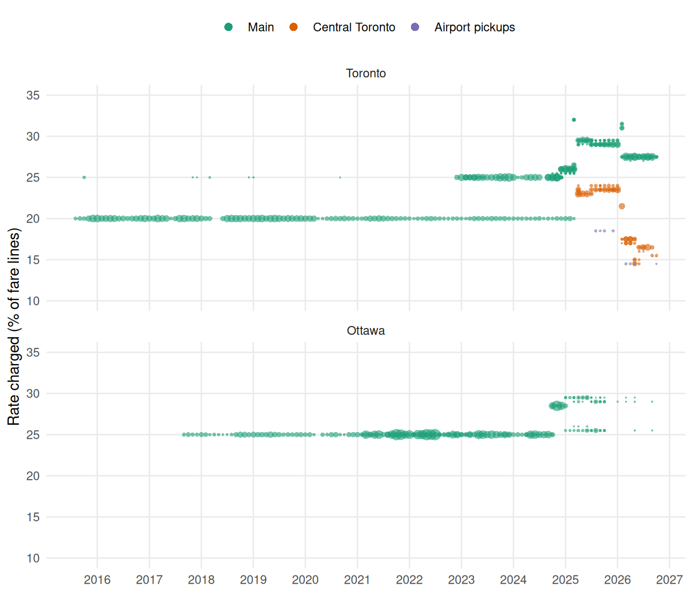
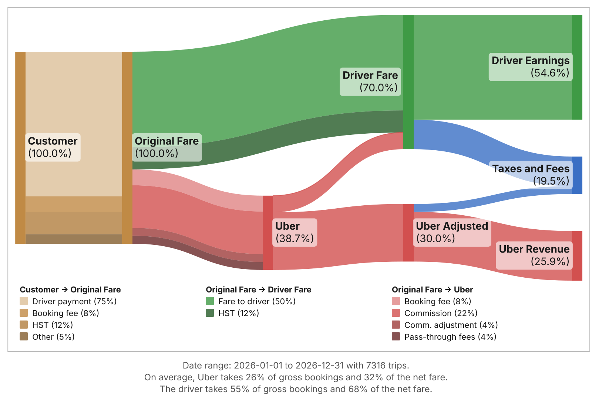
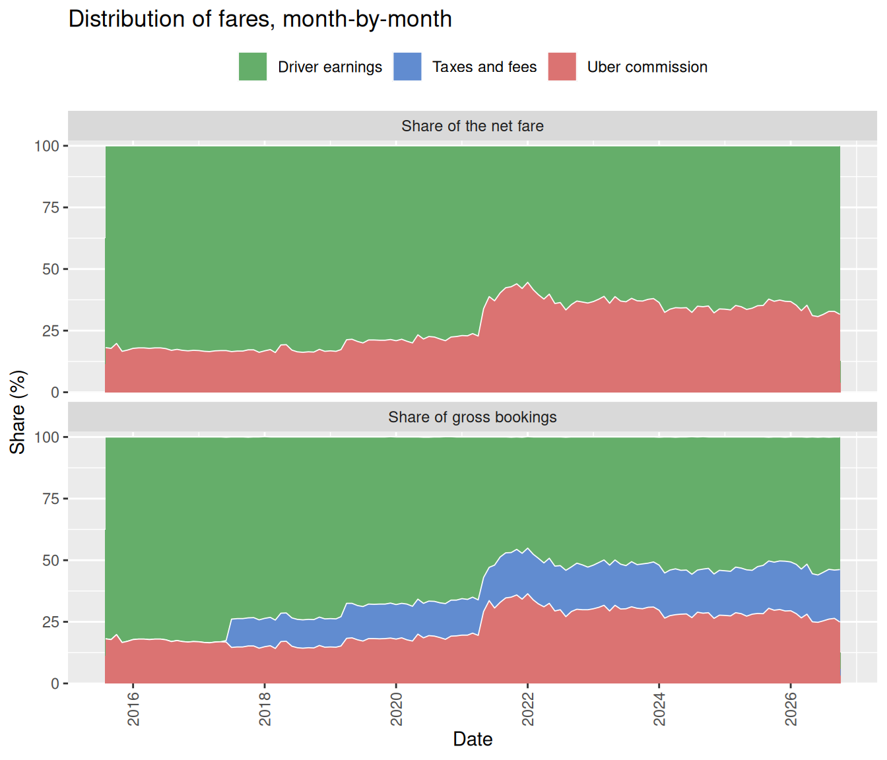

One of the perennial topics in ridehail systems is how much Uber (and others, but let's face it mainly Uber) takes from each fare.
Uber refers to its share of the fare as a commission, as a service fee, and as a "take rate".
Here we use the word "take" to refer to all the money that goes to Uber.

The driver account statements show that the topic is a bit more complex than it seems.
Let's look at some of the measures of Uber's take.

*(If you are an Uber driver, have obtained your account history, and would like a report to make sense of where the money goes, please email info@tomslee.net.
)*

# Base commission

Every driver account statement (see [the previous post](../2026-uberdata-1/index.qmd)) has a line item that is labelled in the Payments file with the category *commission* and the classification *intermediary.commission*, which is a percentage of the fare (without tips, taxes or city fees).
In more recent account statements the percentage is reported in the Trips file as a *service_fee_local*.

The idea of a percentage commission originates from the early days of Uber, when the passenger fare went to the driver (in a "rate card" formula of base fare + distance + time) or to Uber (through the commission and the booking fee).
Even with a small set of driver accounts we can get a good idea of how base commission has changed over the years.

@fig-base-commission shows that Uber's commission has varied with time and place.
For many years Toronto drivers experienced a commission of 20%.
Drivers who joined the platform later experienced a higher commission of 25%.
In October 2024 Uber introduced "upfront fares for drivers" which decoupled driver pay from the passenger fare, and with this they revised the commission rates, charging different rates for central Toronto, pickups at Pearson airport, and the remainder of the city.
Since then Uber has periodically changed the base commission rate for each of these geographies.

{#fig-base-commission}

# Booking fee

Uber has been inconsistent in its bookkeeping and message regarding the booking fee, which they originally called a "safe rides fee".
The previous post showed that in early years, the deduction from the driver was not recorded.
Then from 2019 through mid-2021 (check) the booking fee was not listed at all on driver accounts.
Since then it has been recorded more reliably as a payment (from the passenger) and then as an equal deduction (transferring the money to Uber).
The driver, therefore, does not get any of the booking fee.

@fig-booking-fee shows how the booking fee has changed over the years.
From mid-2017 through to early 2023 it was a fixed fee of \$2.75.
Since then, it has changed from a fixed fee to depending on distance.

{#fig-booking-fee fig-alt="The booking fee charged by Uber, over the years."}

@fig-booking-fee-distance shows in more detail how the booking fee has become a function of distance.
The name itself is now a misnomer: a "booking fee" suggests a fixed fee for handling a transaction, but now it's just one more dial on Uber's pricing algorithm.

{#fig-booking-fee-distance fig-alt="The booking fee has become dependent on the trip distance."}

# Uber's overall take

The base commission and the booking fee were the two major components of Uber's take until the introduction of upfront fares for drivers, in October 2024 (fully implemented in February 2025).
Since then it has become an increasingly complex function, no longer just a fixed percentage.
Various line items (presented in the previous post, and to be analyzed in more detail in following posts) add and subtract from Uber's take, from the driver pay, and from the passenger fare.
While the specifics of those adjustments matter a lot, here we just look at the net result.

@fig-sankey-2026 shows how the customer fare has flowed through the system, for a handful of drivers in 2026.
The numbers in the diagram are not exact, but the overall shape of the flow should be reliable.
Let's walk through it.

Of the fare paid by the passenger, Uber takes an initial cut of 38.7% (including the base commission and the booking fee), but passes some of that back to drivers in the form of incentives for selected trips.
It is the responsibility of the driver to pay the harmonized sales tax (13% of the passenger fare) and Uber has to pay some city fees (typically \$0.40 per trip) and there is a charge of \$6.75 (?)
for trips that start or end at Pearson airport.

{#fig-sankey-2026}

Uber tends to deduct expenses like insurance (which are not listed separately in account histories) from the rates they describe to drivers, but insurance is just one cost of doing business.
Both Uber and the drivers have many costs of doing business, and we do not deduct such costs when calculating the take rate.
The question of driver earnings after their costs (fuel, maintenance, insurance, cleaning etc) and Uber's earnings after costs is separate.

There are several ways we could calculate a "take rate" for Uber.

- *Share of gross bookings.* The numbers shown in the figure are one way to calculate a take rate.
  The customer fare is split between the driver, Uber, and third-parties (cities and airports and taxes), and for the trips here Uber's take rate is 25.9%, with the driver taking just over half of the fare (54.6%)

- *Share of net fare.* Another approach is to leave the taxes and fees out of the calculation, which leaves Uber with about a third (32%) and the drivers with two-thirds (68%) of the total.

- *Everything but the driver's earnings.* If the taxes and fees are seen as part of Uber's cost of operations, just as fuel is seen as part of a driver's cost of operations, then they could be seen as part of Uber's take.
  Calculated this way, Uber's take is everything but the driver's 54.6%, which is 45.4% of the total.
  However, the biggest contributor to taxes and fees is the HST, which (in Ontario at least) is, by regulation, the responsibility of the driver.

@fig-uber-share-gross-net and @tbl-share-by-year, show how Uber's take has changed over time, using all three measures, for trips in Toronto.

{#fig-uber-share-gross-net}

::: {#tbl-share-by-year}
  | Year | Percent of net fare | Percent of gross bookings | All but earnings  |
  | ---- | -----------------:  | -----------------:        | ----------------: |
  | 2019 |                19.7 |                      17.1 |              30.3 |
  | 2020 |                21.8 |                      18.7 |              32.9 |
  | 2021 |                37.5 |                      31.2 |              48.0 |
  | 2022 |                37.9 |                      31.2 |              48.9 |
  | 2023 |                37.5 |                      31.0 |              48.3 |
  | 2024 |                33.9 |                      30.7 |              40.1 |
  | 2025 |                35.3 |                      28.7 |              47.4 |
  | 2026 |                33.3 |                      26.7 |              46.5 |

Uber's share of the net fare, of gross bookings, and of everything but the driver's earnings.
The numbers are for a small sample of drivers in Toronto and Ottawa, averaged over each year.
:::

Perhaps the bigger story, to be tackled in a future post, is that Uber's take is now algorithmically tuned, trip by trip, and varies.
The average is not the only thing that matters.
