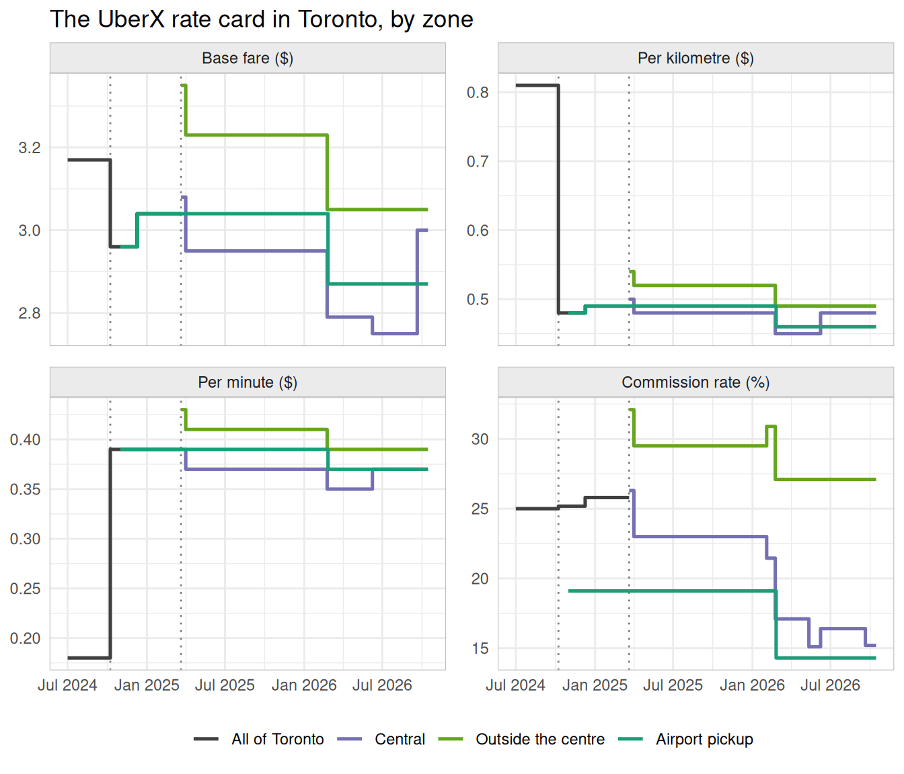
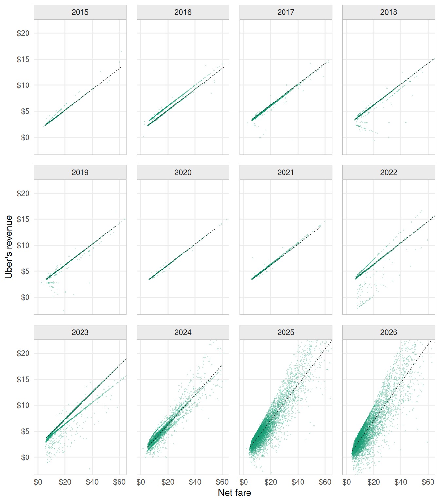

If you take a trip on the TTC or many other public transit systems, you pay a flat fare.
That is, the fare is the same no matter where your starts, where it ends, or what day of the week it is.
Some cities may have zones with different fares for different zones, and you can buy monthly passes, but roughly speaking a trip is a trip is a trip.

Taxis have operated differently.
Instead of a fixed fare, most taxi fares are set by a rate card: a simple formula with a fixed minimum fare, a distance rate and a time rate.
Still, there is a single formula that applies to pretty much all trips.
The same goes for drivers: they get paid according to a straightforward formula.
Roughly speaking, a trip is still a trip is a trip.

Uber also started out with rate card fares, with a simple formula for its own commission.
A trip was a trip.
But over the last few years it has unbundled the idea of a trip.
Depending on a myriad of factors, each trip is charged differently, drivers are paid in ways that don't follow the passenger fare, and opaque algorithms with unstated optimization goals adjust each trips finances up and down.
A trip is no longer a trip.
A trip one minute is different from a trip two minutes later.

One goal of this series of posts was to try to understand how Uber has gone about setting passenger fares and driver pay.
It is still very much a work in progress, and there are many questions I've not been able to answer.
Still, what I'll do in this and subsequent posts is set out some of the steps Uber has taken to unbundle trips as it moves from rate card pricing to algorithmic pricing.

*(If you are an Uber driver and you would be prepared to get your account history from Uber and share it with me, I'll give you a report to make sense of where the money from your trips has gone.
Also, your data would make a valuable addition to solving some of the puzzles set out here.
I'd keep it confidential, although I would give you credit as a project contributor if you want.
Please email me at info\@tomslee.net.
)*

# Unbundling the rate card {#trip-2016}

I always thought of algorithmic pricing as working like this:

- Start with ye olde rate card fare and ye olde commission.

- Adjust according to \<factors\> to give the final passenger fare and driver pay.

A thing I missed was that "ye olde rate card" and "ye olde commission" can itself be tweaked, and Uber has done this over the last few years, so that the rates and fare and driver pay all depend on where the trip starts.

The previous post showed that the commission split with the introduction of Upfront fares for drivers, in late 2024 and early 2025.
Also, that there were different commission levels for long-time and newer drivers.
See [here](/posts/2026-uberdata-2/index.qmd#fig-base-commission).
But other parts of the rate card changed too.

@tbl-rate-card shows the different rate cards that have been applied to fares in Toronto since the introduction of upfront fares for drivers in October 2024.
@fig-rate-cards shows the same information graphically.

::: {#tbl-rate-card}
  | Zone         | From       | To         | Base | Per km | Per min | Commission |
  | :----------- | :--------- | :--------- | ---: | -----: | ------: | ---------: |
  | All Toronto  | 2024-07-01 | 2024-10-07 | 3.17 |   0.81 |    0.18 |      25.0% |
  |              | 2024-10-08 | 2024-12-08 | 2.96 |   0.48 |    0.39 |      25.2% |
  |              | 2024-12-09 | 2025-03-20 | 3.04 |   0.49 |    0.39 |      25.8% |
  | Central      | 2025-03-21 | 2025-03-31 | 3.08 |   0.50 |    0.39 |      26.3% |
  |              | 2025-04-01 | 2026-02-02 | 2.95 |   0.48 |    0.37 |      23.0% |
  |              | 2026-02-03 | 2026-02-22 | 2.95 |   0.48 |    0.37 |      21.4% |
  |              | 2026-02-23 | 2026-05-11 | 2.79 |   0.45 |    0.35 |      17.1% |
  |              | 2026-05-12 | 2026-06-07 | 2.79 |   0.45 |    0.35 |      15.1% |
  |              | 2026-06-08 | 2026-09-19 | 2.75 |   0.48 |    0.37 |      16.4% |
  |              | 2026-09-20 |            | 3.00 |   0.48 |    0.37 |      15.2% |
  | Outside      | 2025-03-21 | 2025-03-31 | 3.35 |   0.54 |    0.43 |      32.1% |
  |              | 2025-04-01 | 2026-02-02 | 3.23 |   0.52 |    0.41 |      29.5% |
  |              | 2026-02-03 | 2026-02-22 | 3.23 |   0.52 |    0.41 |      30.9% |
  |              | 2026-02-23 |            | 3.05 |   0.49 |    0.39 |      27.1% |
  | Airport      | 2024-10-31 | 2024-12-09 | 2.96 |   0.48 |    0.39 |      19.1% |
  | pickup       | 2024-12-10 | 2026-02-24 | 3.04 |   0.49 |    0.39 |      19.1% |
  |              | 2026-02-25 |            | 2.87 |   0.46 |    0.37 |      14.3% |

The components of the rate card fare and Uber's base commission observed in a small sample of Toronto driver trips.
:::

One big change that Uber made, and promoted publicly as a "rebalancing", was to reduce the per-kilometre rates and increase the per-minute rate, which had the effect of higher prices for short, slow downtown trips and lower prices for longer highway trips (at least, those not caught in Highway 401 or Gardner Express congestion).
However, this also marks one step in the unbundling of trips, with trips in central Toronto being charged in a different way to those outside the centre, and with airport trips moving to their own pay and fare schedule.

Further, this was not a one-time event.
Like other aspects of algorithmic pricing that we will see, Uber has continued to adjust the values, increasing them here, decreasing them there.

{#fig-rate-cards}

# Unbundling beyond the rate card

It's not just the rate card amounts that have changed.
@fig-price-scatter-facet shows how algorithmic pricing has affected the variability in the money Uber makes for each trip.
It's a complicated diagram, so let's walk through it.

{#fig-price-scatter-facet}

Start with 2015 the plot at top left.
Every green dot represents a trip, with the net fare (without taxes and fees) on the x axis and Uber's revenue on the y axis.
A single "rate card" model should give a straight line that hits the y axis were the fixed booking fee is (about $2.50), and then increases as Uber takes a regular fraction of each dollar that the passenger pays.
And that's pretty much what we see.
It might not be obvious, but a dotted black line is drawn to show the calculated rate card, and the dots all cluster very close to the line.

In 2016 the dots form two parallel lines, and this represents the first half of the year (at one booking fee) and the second half of the year at an increased booking fee.
This new rate card remains in effect for almost all trips through to 2022.

Most of the 2015 to 2022 trips come from a single long-time driver.
New drivers in the sample start in 2022, and Uber takes a bigger commission from these new drivers, leading to the faint steeper line.

In 2023 most of the trips care carried out by these new drivers, and the steeper line is more pronounced.

Towards the end of 2024 the upfront fare for drivers is introduced, and all of a sudden there are many dots that appear above and below the rate card line.
This scatter becomes broader in 2025 and 2026.
Uber takes more than the rate card from some trips, and less than the rate card from others.

Uber's take rate, which is the average line through these points, has not changed much between 2023 and 2026, as we saw in the previous post, but that doesn't mean nothing happened.

What seems to be happening here is that there are some trips where Uber was leaving money on the table: where the driver would take the request for less, or the passenger would be prepared to pay more, and Uber was just charging the rate card.
With algorithmic pricing of individual trips, Uber can increase the fare it charges the passenger or cut the payment it makes to the driver and both will still take the trip.
Uber is probing the passenger and driver "willingness to pay" (WTP) amount for each trip.

There are other trips for which Uber is taking less than the rate card amount.
These are trips that passengers may walk away from as "not worth the price" if it were offered at the usual rate card fare, or which drivers may decide are not worth taking.
For Uber, any trip that brings in money is better than no trip, so the algorithm spots conditions where this may be the case and provides incentives for drivers or passengers to make it worth their while.

Both increases and decreases to Uber's take benefit the company: Uber aims to take all of what economists call the "consumer surplus".
An ideal trip for Uber is one where passengers pay just as much as they are willing to pay, and drivers take just as little as they are willing to put up with.

There does not seem to be enough information in driver account histories to unpick all the factors that go into Uber's pricing algorithm, but the next post (or two), will at least show the line items that Uber uses to fine tune its pricing.
